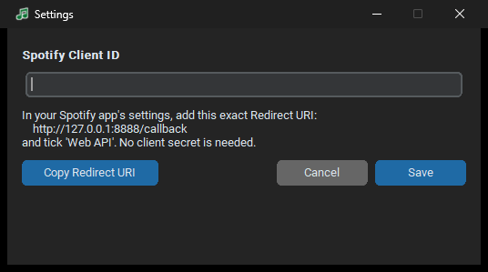
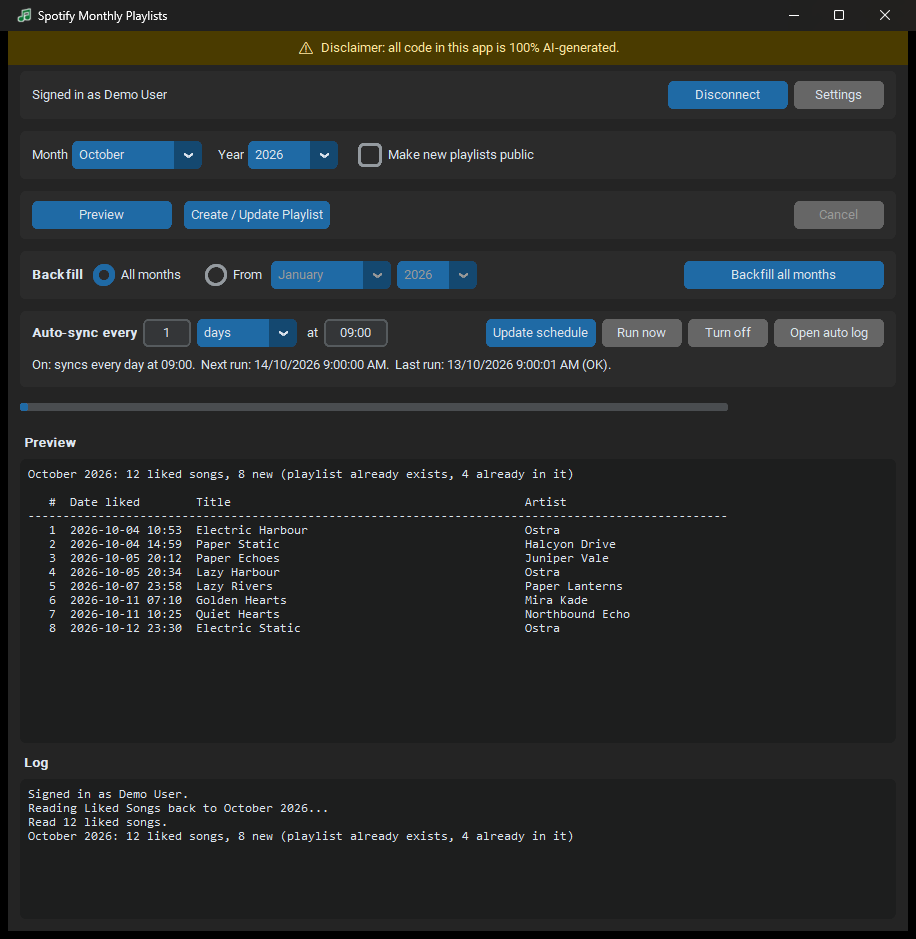
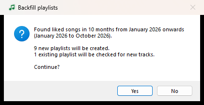
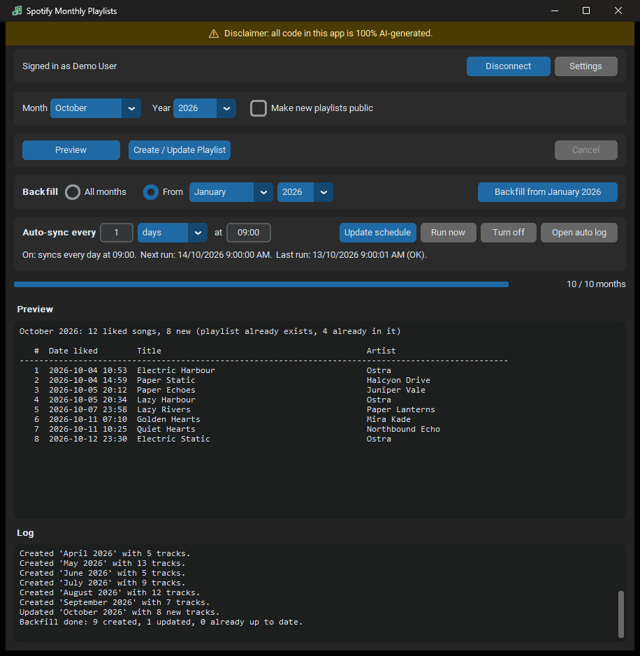
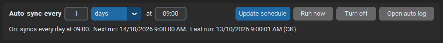

# User Guide: Spotify Monthly Playlists

> [!WARNING]
> **Disclaimer:** All code in this project is 100% AI-generated. Review it before you
> rely on it, and use it at your own risk.

This guide covers using the app from first launch to fully automatic monthly
playlists. Screenshots use made-up demo songs and a demo account.

**Contents**

1. [Before you start: get a Client ID](#1-before-you-start-get-a-client-id)
2. [First launch: enter your Client ID](#2-first-launch-enter-your-client-id)
3. [Connect your Spotify account](#3-connect-your-spotify-account)
4. [A tour of the main window](#4-a-tour-of-the-main-window)
5. [Preview a month](#5-preview-a-month)
6. [Create or update a month's playlist](#6-create-or-update-a-months-playlist)
7. [Backfill many months at once](#7-backfill-many-months-at-once)
8. [Turn on automatic sync](#8-turn-on-automatic-sync)
9. [Disconnecting, privacy and where things are stored](#9-disconnecting-privacy-and-where-things-are-stored)
10. [FAQ](#10-faq)

---

## 1. Before you start: get a Client ID

The app talks to Spotify through your own free Spotify developer app. This takes
about two minutes and you only do it once:

1. Go to <https://developer.spotify.com/dashboard>, log in, and click **Create app**.
2. Give it any name and description.
3. Under **Redirect URIs**, add exactly `http://127.0.0.1:8888/callback`.
4. Tick **Web API**, then **Save**.
5. Open the app's **Settings** and copy the **Client ID**. You don't need the client secret.

> Spotify's Development Mode requires the developer account that owns the app to
> have **Spotify Premium**.

## 2. First launch: enter your Client ID

Download `SpotifyMonthlyPlaylists.exe` from the
[latest release](https://github.com/widowshyper/spotify-monthly-playlists/releases/latest) and run it. There's nothing to install.

> The exe isn't code-signed, so Windows SmartScreen may say *"Windows protected your
> PC"*. Click **More info**, then **Run anyway**.

On first launch the **Settings** window opens:

- Paste your **Client ID** and click **Save**.
- **Copy Redirect URI** copies `http://127.0.0.1:8888/callback`, ready to paste into
  the Spotify dashboard if you haven't added it yet.

You can reopen this window any time with the **Settings** button.

## 3. Connect your Spotify account

Click **Connect**. Your web browser opens Spotify's login and permission page:

1. Log in if asked, then click **Agree**.
2. The browser tab says *"You're connected"*, and you can close it.
3. Back in the app, the top bar reads **Signed in as &lt;your name&gt;**.

You only do this once. The app remembers your login and renews it automatically.

## 4. A tour of the main window

From top to bottom:

| Area | What it does |
|------|--------------|
| **Disclaimer bar** | A reminder that the app's code is AI-generated. |
| **Account bar** | Shows who's signed in. **Connect/Disconnect** and **Settings**. |
| **Month / Year** | The month to work on. Defaults to the current month. |
| **Make new playlists public** | Off by default, so new playlists are private. Only affects playlists the app *creates*. Existing playlists are never changed. |
| **Preview** | Shows which songs would be added, without changing anything. |
| **Create / Update Playlist** | Creates the playlist for the selected month, or adds any missing songs to it. |
| **Backfill row** | Does the same for many months: **All months**, or **From** a chosen month and year up to now. See [section 7](#7-backfill-many-months-at-once). |
| **Cancel** | Stops a running backfill or login. |
| **Auto-sync row** | Runs the app automatically on a schedule. See [section 8](#8-turn-on-automatic-sync). |
| **Progress bar** | Busy indicator, or "N / M months" during a backfill. |
| **Preview panel** | The list from the last Preview. |
| **Log** | Everything the app did: created, updated, skipped, and any errors. |

## 5. Preview a month

Pick a **Month** and **Year** and click **Preview**. Nothing on Spotify changes.

The preview panel lists every song you liked that month that **isn't already** in the
playlist, oldest first, with the date and time you liked it in your local time. The
header line sums it up:

- *"October 2026: 12 tracks would be added to a new playlist"*: the playlist doesn't exist yet.
- *"October 2026: 12 liked songs, 8 new (playlist already exists, 4 already in it)"*:
  the playlist exists and 8 songs are missing from it.

> **How months are decided:** Spotify records likes in UTC. The app converts each one
> to your computer's timezone first, so a song you liked at 9am on 1 November in
> Tasmania counts as November, even though it was still 31 October in UTC.

## 6. Create or update a month's playlist

Click **Create / Update Playlist**. The log then shows one of these:

| Log message | Meaning |
|-------------|---------|
| `Created 'October 2026' with 12 tracks.` | A new playlist was made, ordered oldest-liked first. |
| `Updated 'October 2026' with 3 new tracks.` | The playlist already existed. Only the missing songs were added, at the end. |
| `Skipped 'October 2026': already up to date.` | Nothing to do. |
| `Skipped 'March 2025': no liked songs that month.` | Empty months never get a playlist. |

It's always safe to click again:

- The app only adds to a playlist with **exactly** that name that **you** own. It
  never makes a duplicate.
- It **never removes** songs, so songs you add to the playlist yourself stay put.
- New playlists get the description *"Liked songs from October 2026. Auto-generated."*

## 7. Backfill many months at once

The **Backfill** row creates or updates a playlist for many months in one go. Choose
how far back to go:

- **All months**: every month in your Liked Songs history. The button reads
  **Backfill all months**.
- **From [Month] [Year]**: only that month and every month after it, up to now. Pick
  a month and year, and the button changes to e.g. **Backfill from January 2026**.
  This is quicker for big libraries, because the app stops reading your Liked Songs
  once it reaches that month. It's handy if you already have older monthly playlists,
  or only want recent ones. Months in the future aren't allowed.

Click the button. The app reads your Liked Songs, then asks for confirmation:

Click **Yes** to start. The progress bar counts through the months, and the log lists
each playlist as it's created or updated. **Cancel** stops it after the current month.

A big library with thousands of liked songs can take a minute or two to read. If
Spotify asks the app to slow down, it waits automatically and notes this in the log.

## 8. Turn on automatic sync

With auto-sync on, Windows runs the app in the background on a schedule, even when
the app is closed. Each run syncs **last month** and **this month**, then exits.

1. Type a number, pick **hours**, **days**, **weeks** or **months**, and set a time
   (24-hour `HH:MM`).
2. Click **Save schedule**. The status line changes to *"On: syncs every day at
   09:00. Next run: ..."*.

Good choices:

| Setting | Effect |
|---------|--------|
| `1 days at 09:00` | **Recommended.** This month's playlist grows every morning, and last month's is finished on the 1st. |
| `6 hours at 08:00` | Near-real-time. New likes show up within a few hours. |
| `1 weeks at 18:00` | Weekly, on the weekday you first saved it. |
| `1 months at 09:00` | Just once a month, on the 1st. |

The other buttons:

- **Run now** starts a sync immediately in the background.
- **Open auto log** shows what the background runs did.
- **Turn off** removes the schedule completely.
- **Update schedule**: change the values and click it. Also click it if you **move
  the exe** to another folder.

Good to know:

- If your PC is off or asleep at the scheduled time, the run happens as soon as it's
  back on.
- Runs only happen while you're logged in to Windows, and they need internet.
- You must have clicked **Connect** at least once. Otherwise the status shows
  *"not set up"*.
- Behind the scenes this is a normal Windows Task Scheduler task called
  `SpotifyMonthlyPlaylists\Auto Sync`.

## 9. Disconnecting, privacy and where things are stored

- **Disconnect** deletes the saved login from your PC. To fully revoke access, also
  remove the app at <https://www.spotify.com/account/apps/>.
- The app only uses these permissions: read your Liked Songs, read your playlists,
  and create or modify playlists. It never deletes anything.
- Everything is stored in `%APPDATA%\SpotifyMonthlyPlaylists\`. Paste that into the
  Explorer address bar to open it:
  - `config.json`: your Client ID and schedule choice
  - `token.json`: your Spotify login (keep it private)
  - `app.log`: what happened in the app
  - `auto.log`: what happened in scheduled runs
- To uninstall: click **Turn off** (if auto-sync is on), then **Disconnect**. Then
  delete the exe and the folder above.

## 10. FAQ

**A song I liked isn't in the playlist.**
Check which month it falls in using your local time. Local files (songs imported from
your computer) can't be added to playlists through the API, so they're skipped.

**I unliked a song. Will it be removed from the playlist?**
No. The app never removes songs.

**I renamed a monthly playlist and now the app made a new one.**
The app matches playlists by exact name, for example `October 2026`. Rename it back,
and delete the new copy in Spotify, to merge them again.

**Can I use it on a Mac or Linux?**
Yes, from source (see the [README](../README.md#5-running-from-source)). The
auto-sync row is Windows-only. Use cron or launchd to run `main.py --auto` instead.

**I see an error.**
See [Troubleshooting](../README.md#troubleshooting) in the README for each error
message and its fix.
